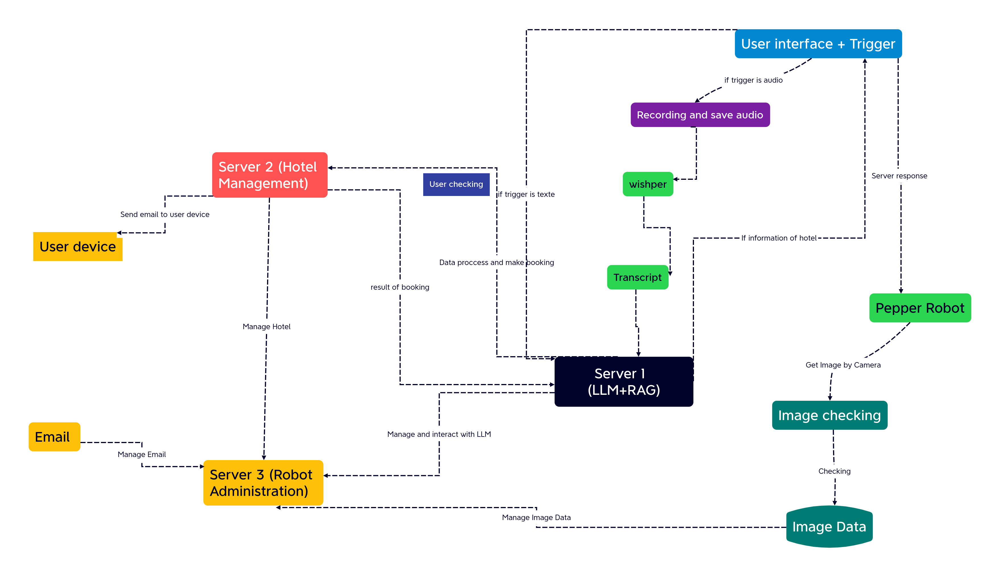

<div align="center">


# AMS Project Workspace

**An LLM-powered hotel assistant: FastAPI backend, Pepper robot integration, vision and speech**


*Retrieval-augmented chat, real-time streaming, speech transcription, face recognition and reservation automation, wired to a hotel robot.*

</div>

---

## Table of contents

- [Overview](#overview)
- [Architecture](#architecture)
- [Features](#features)
- [Repository layout](#repository-layout)
- [Tech stack](#tech-stack)
- [Quick start](#quick-start)
- [Configuration](#configuration)
- [Testing](#testing)
- [Project documents](#project-documents)
- [Contributing](#contributing)

---

## Overview

AMS is a multi-component repository for a **hotel assistant**. A FastAPI backend serves LLM-driven chat and retrieval, a robot application handles vision, speech and conversation flows on the robot side, and a test suite covers both.

| Component | Role |
|---|---|
| [`ams_project_llm`](ams_project_llm) | FastAPI backend: LLM services, CRUD and DB layer, schemas, QR codes and static assets. Served with `uvicorn`, persisted with `SQLAlchemy`. |
| [`robot_hotel`](robot_hotel) | Robot application: robot integration, LLM interaction, vision (YOLO and face models) and ML tooling. Entry point: `main.py`. |
| [`tests`](tests) | Unit and integration tests with `pytest` and fixtures. |

## Architecture

<p align="center">
  
</p>


The editable mind maps are in [`Server.xmind`](Server.xmind), [`ASR.xmind`](ASR.xmind) and [`Audio.xmind`](Audio.xmind). An interactive view of the flow is in [`workflow_diagram.html`](workflow_diagram.html).

## Features

| Area | What it does |
|---|---|
| **LLM and RAG** | Index-based retrieval, document ingestion and RAG workflows with LlamaIndex. |
| **Real-time chat** | HTTP and WebSocket APIs with streaming responses (FastAPI, Uvicorn). |
| **Robot integration** | Pepper test scripts, robot control and conversation flows. |
| **Vision** | Face recognition, YOLOv8 object detection, OpenCV capture and processing. |
| **Speech** | Whisper-based transcription and audio handling. |
| **Hotel operations** | Reservation automation and email sending. |
| **Assets** | QR code generation and static file delivery. |
| **Quality** | `pytest` suite with fixtures for unit and integration tests. |

## Repository layout

```text
.
├── ams_project_llm/                 # FastAPI backend (LLM, DB, schemas, static assets)
├── robot_hotel/                     # Robot app (vision, speech, LLM interaction)
├── tests/                           # pytest unit and integration tests
├── Server.png / Server.xmind        # Server architecture
├── ASR.png / ASR.xmind              # ASR pipeline
├── Audio.xmind                      # Audio processing map
├── WORKFLOW.md                      # Workflow description
├── workflow_diagram.html            # Interactive workflow diagram
├── CAHIER_DES_CHARGES_XMIND.md      # Specification (mind map notes)
├── cahier_des_charges.tex           # Specification (LaTeX)
├── presentation_cahier_des_charges.tex
├── rapport_ams_interspeech.tex/.pdf # Interspeech-format report
├── research_article.md              # Research article draft
├── TODO.md / TODO_REFACTOR.md       # Roadmap and refactoring notes
├── pytest.ini
└── README.md / README.fr.md / README.es.md
```

## Tech stack

| Layer | Tools |
|---|---|
| Runtime | Python 3.12 |
| Web | FastAPI, Flask, Starlette, Uvicorn (uvloop), `websockets`, `httpx`, `aiohttp` |
| Data | SQLAlchemy, aiosqlite, Pydantic |
| LLM and RAG | LlamaIndex, OpenAI, Ollama, Hugging Face, `transformers`, `sentence-transformers`, `tiktoken` |
| Deep learning | PyTorch, Triton (where present) |
| Vision | OpenCV, `face-recognition`, Ultralytics YOLOv8 |
| Speech | Whisper (wrapper in `services/whisper.py`) |
| Utilities | `qrcode`, PyYAML, `python-dotenv`, requests, pandas, scikit-learn, numpy |

## Quick start

Each component has its own requirements file. Install only what you plan to run.

| Component | Requirements file |
|---|---|
| Backend | `ams_project_llm/requirements.txt` |
| Robot app | `robot_hotel/requirement.txt` |

**1. Create and activate a virtual environment**

```bash
python -m venv env
source env/bin/activate
pip install -r ams_project_llm/requirements.txt
```

**2. Run the LLM backend**

```bash
cd ams_project_llm
uvicorn main:app --reload
```

**3. Run the robot app**

```bash
cd robot_hotel
pip install -r requirement.txt
python main.py
```

## Configuration

- Environment variables go in `.env` files, loaded with `python-dotenv`.
- Mail settings live in `config/email_config.json`.

## Testing

From the repository root:

```bash
pytest -q
```

## Project documents

| Document | Content |
|---|---|
| [`WORKFLOW.md`](WORKFLOW.md) | System workflow |
| [`CAHIER_DES_CHARGES_XMIND.md`](CAHIER_DES_CHARGES_XMIND.md) | Specification derived from the mind maps |
| [`cahier_des_charges.tex`](cahier_des_charges.tex) | Full specification (LaTeX) |
| [`rapport_ams_interspeech.pdf`](rapport_ams_interspeech.pdf) | Report in Interspeech format |
| [`research_article.md`](research_article.md) | Research article draft |
| [`TODO.md`](TODO.md), [`TODO_REFACTOR.md`](TODO_REFACTOR.md) | Roadmap and refactoring plan |

## Contributing

Open an issue or a pull request. Run the tests and keep the style consistent before submitting.

---

<div align="center">

Maintained by [Kekeli Christ KELI](https://github.com/KELI-Kekeli-Christ)

</div>
