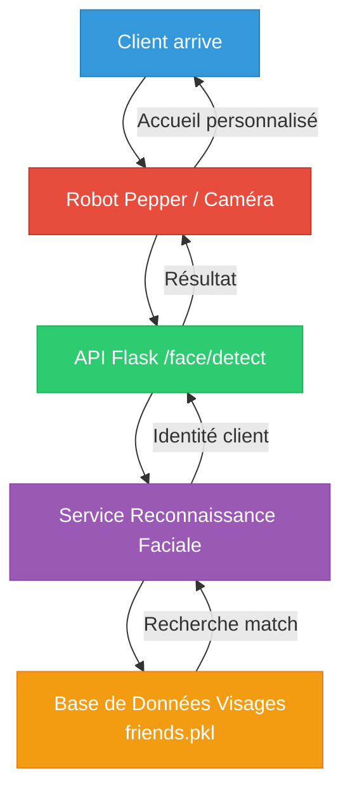
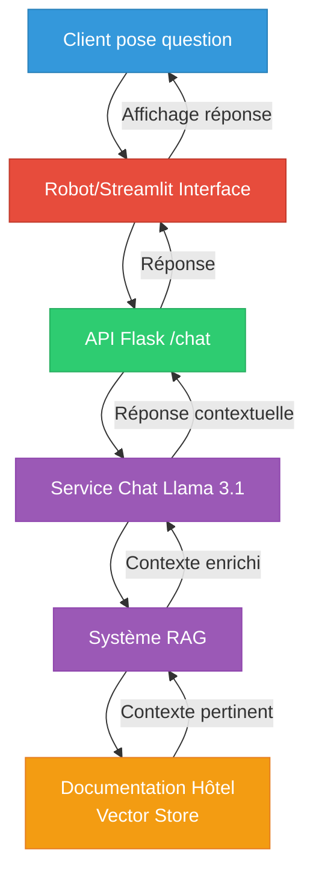
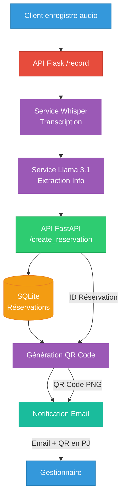
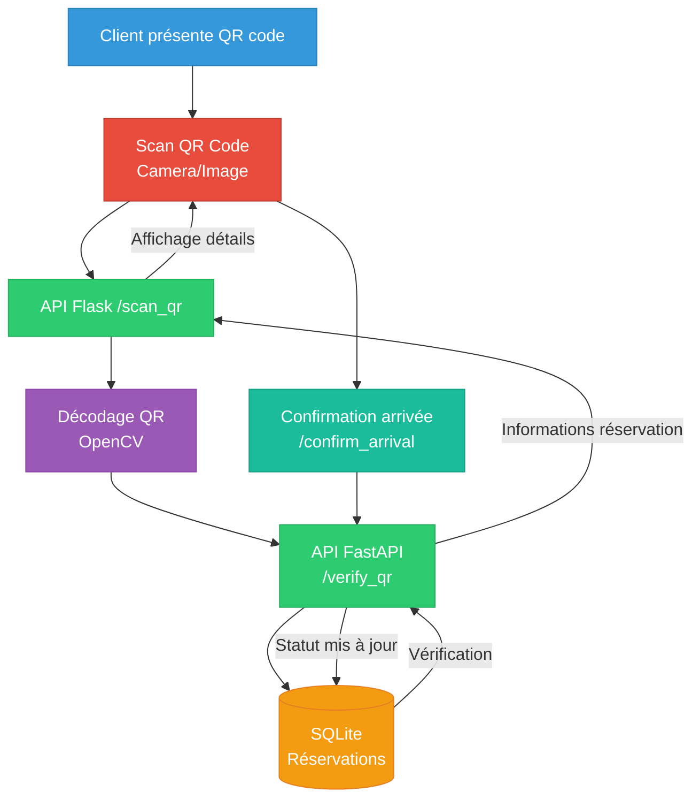
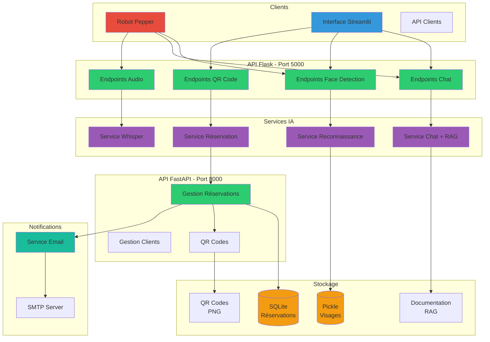

# Workflow Système Robot Hotel

## Vue d'ensemble

Le système Robot Hotel comprend 3 workflows principaux qui couvrent les interactions utilisateur de bout en bout.

---

## Workflow 1 : Reconnaissance Faciale et Accueil Personnalisé



### Étapes détaillées :
1. **Client arrive** → Se place devant le robot ou la caméra
2. **Photo capturée** → Image envoyée à l'API Flask
3. **Détection faciale** → Utilisation de YOLOv8 + face_recognition
4. **Recherche en base** → Comparaison avec encodages stockés
5. **Match trouvé** → Identité du client récupérée
6. **Accueil personnalisé** → Message adapté au client reconnu

---

## Workflow 2 : Interaction avec le Chatbot



### Étapes détaillées :
1. **Question utilisateur** → Texte ou audio
2. **Envoi à l'API** → Endpoint `/chat` de Flask
3. **Recherche RAG** → Recherche sémantique dans documentation
4. **Contexte récupéré** → Informations pertinentes extraites
5. **Génération réponse** → Llama 3.1 avec contexte temporel (date/heure)
6. **Réponse affichée** → Réponse contextuelle à l'utilisateur

---

## Workflow 3 : Création de Réservation par Voix



### Étapes détaillées :
1. **Enregistrement audio** → Client parle sa demande de réservation
2. **Transcription Whisper** → Audio converti en texte
3. **Extraction informations** → Llama 3.1 extrait :
   - Nom et prénom
   - Dates (convertit dates relatives → absolues)
   - Type de chambre
4. **Création client** → Si client n'existe pas, création automatique
5. **Création réservation** → Sauvegarde dans SQLite via FastAPI
6. **Génération QR code** → QR code PNG généré et stocké
7. **Notification email** → Email envoyé au gestionnaire avec :
   - Détails de la réservation
   - QR code en pièce jointe

---

## Workflow 4 : Vérification QR Code (Check-in)



### Étapes détaillées :
1. **Scan QR code** → Via caméra Streamlit ou upload image
2. **Décodage** → OpenCV décode le QR code (récupère ID réservation)
3. **Vérification** → Appel API FastAPI pour récupérer les détails
4. **Affichage informations** → Réservation + Client affichés
5. **Confirmation arrivée** → Statut mis à jour en "arrivé"

---

## Architecture Système



---

## Flux de Données

### Reconnaissance Faciale
```
Image → YOLOv8 → face_recognition → Encodage → Comparaison → Match/Non-match
```

### Chatbot avec RAG
```
Question → Embedding → Recherche Vectorielle → Contexte → Llama 3.1 → Réponse
```

### Réservation
```
Audio → Whisper → Texte → Llama 3.1 Extraction → FastAPI → SQLite → QR Code → Email
```

---

## Technologies Utilisées par Workflow

### Workflow 1 (Reconnaissance)
- **YOLOv8** : Détection de visages
- **face_recognition** : Encodage et reconnaissance
- **Pickle** : Stockage encodages

### Workflow 2 (Chat)
- **Llama 3.1-8B-Instruct** : Modèle de langage
- **LlamaIndex** : Indexation vectorielle
- **HuggingFace Embeddings** : Embeddings sémantiques

### Workflow 3 (Réservation)
- **Whisper Medium** : Transcription audio
- **Llama 3.1** : Extraction d'informations
- **FastAPI** : API réservations
- **SQLite + SQLAlchemy** : Base de données
- **qrcode** : Génération QR codes
- **smtplib** : Envoi emails

### Workflow 4 (QR Code)
- **OpenCV** : Décodage QR codes
- **FastAPI** : Vérification réservations

---

## Gestion des Erreurs

Chaque workflow inclut :
- **Validation des inputs** : Vérification données entrantes
- **Gestion d'erreurs** : Messages clairs en cas d'échec
- **Fallback** : Solutions de secours (ex: CPU si GPU saturé)
- **Logs** : Traçabilité complète des opérations

---

## Performances

### Temps de réponse attendus :
- **Reconnaissance faciale** : < 3 secondes
- **Réponse chatbot** : < 5 secondes
- **Transcription audio** : < 10 secondes (selon longueur)
- **Création réservation** : < 30 secondes (workflow complet)

---

## Diagramme Image

Un diagramme visuel détaillé est disponible dans :
- `workflow_robot_hotel.png` (image haute résolution)
- `workflow_robot_hotel.pdf` (format vectoriel)

Pour régénérer le diagramme :
```bash
python3 generate_workflow_diagram.py
```

